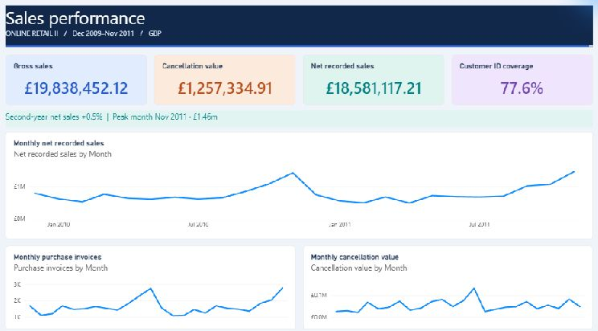

# Retail Sales and Customer Performance

This portfolio project analyses real invoice activity from a UK-based online retailer using [UCI Online Retail II](https://archive.ics.uci.edu/dataset/502/online+retail+ii). It covers sales and cancellations, product and market mix, and repeat purchasing.

**£18.58m in net recorded sales** across the 24 complete months. Gross sales grew 1.7% in the second year, but higher cancellation value absorbed about 71% of the increase. Among identified purchasers, 71.8% placed at least two orders.

## Open the Online Retail II project

| Deliverable | Open |
| --- | --- |
| Power BI | [Retail Sales and Customer Performance](powerbi/Retail%20Sales%20and%20Customer%20Performance.pbip) |
| Tableau | [Retail Sales and Customer Performance](tableau/Retail%20Sales%20and%20Customer%20Performance.twbx) |
| Written analysis | [Online retail trading and customer insights](docs/online-retail-insights.md) |



[View the Tableau customer retention dashboard preview](docs/screenshots/tableau-retention.png).

## Source profile

The official workbook contains **1,067,371 invoice lines**, exactly matching [UCI's published count](https://archive.ics.uci.edu/dataset/502/online+retail+ii). The sheets span December 1, 2009 to December 9, 2010 and December 1, 2010 to December 9, 2011, respectively. Their date ranges overlap December 1–9, 2010.

| Raw workbook metric | Year 2009-2010 | Year 2010-2011 | Combined |
| --- | ---: | ---: | ---: |
| Source invoice lines | 525,461 | 541,910 | 1,067,371 |
| Missing customer ID | 107,927 (20.54%) | 135,080 (24.93%) | 243,007 (22.77%) |
| Missing description | 2,928 | 1,454 | 4,382 |
| Cancellation-coded lines | 10,206 | 9,288 | 19,494 |
| Distinct cancellation invoices | 4,592 | 3,836 | 8,292 |
| Non-positive price | 3,690 | 2,517 | 6,207 |
| Zero price | 3,687 | 2,515 | 6,202 |
| Negative price | 3 | 2 | 5 |
| Non-positive quantity | 12,326 | 10,624 | 22,950 |
| Zero quantity | 0 | 0 | 0 |
| Negative quantity | 12,326 | 10,624 | 22,950 |
| Exact duplicate occurrences beyond the first | 6,865 | 5,268 | 34,335 |

After counting 6,865 and 5,268 repeat occurrences within the individual sheets, another 22,202 distinct eight-field rows match across sheets. This leaves 1,033,036 distinct rows across the workbook. The combined cancellation-invoice count is taken across both sheets, with 136 cancellation invoice codes shared between them. The exception counts can overlap.

Of the 19,494 cancellation-coded lines, one has a positive quantity and all have positive prices. Another 3,457 negative-quantity lines lack the cancellation prefix.

## Cleaning rules for the invoice-line model

- Preserve every raw row for reconciliation and carry the source sheet and row number into the staging data. For reporting, retain the first occurrence of each exact eight-field row in workbook order across both sheets. The workbook lacks a line ID, so exact matches can include legitimate repeated lines. Document the impact of this rule when reconciling the reported metrics.
- Keep missing customer IDs null. Include eligible unidentified lines in sales and product measures and report customer ID coverage. Build repeat-purchase and cohort measures from eligible purchases with known customer IDs.
- Define gross sales using invoices without the cancellation prefix and with positive quantity and price. Identify cancellations by the invoice prefix and measure their value using lines with negative quantity and positive price. Compute net recorded sales as gross sales less the positive magnitude of those cancellation lines, using the cancellation invoice date.
- Keep zero or negative prices, non-cancellation lines with negative quantity, and cancellation lines with non-negative quantity available for reconciliation. Exclude them from gross sales, cancellation value, and purchase counts. Retain the stock code when its description is blank.
- Use invoice dates to assign periods and limit monthly comparisons to fully covered months. Treat December 2011 as partial.

## Reproduce the source profile

Extract `online_retail_II.xlsx` into `data/raw/` from the [official UCI archive](https://archive.ics.uci.edu/static/public/502/online%2Bretail%2Bii.zip). Git ignores the entire `data/` directory.

From this project directory, run the following with Python 3.11+ and `openpyxl` installed.

```sh
python profile_workbook.py
```

The script reports raw counts before any filtering. It skips the header in each sheet, treats blank or whitespace-only IDs as missing, and counts cancellations using a case-insensitive `C` invoice prefix. An exact duplicate matches all eight parsed source cells, including blanks and the invoice timestamp. Duplicate counts are occurrences after the first, and the combined count also accounts for matches across sheets.

Workbook SHA-256 `bcbe73b35f5b7babf197fb0cb983a11f5d9ff929078d4aa53d171b1f2df2e980`.

## Build and query the SQLite model

Run from this project directory with Python 3.11+ and `openpyxl` installed.

```sh
python build_model.py
```

Open `data/model/retail.sqlite` in a SQLite client. Each build replaces the database after it finishes loading and checks the dimension links. The database lives under the Git-ignored `data/` directory.

| Table or view | Grain and purpose |
| --- | --- |
| `stage_invoice_line` | One source row, including duplicates, with its workbook sheet and row number |
| `fact_invoice_line` | One retained invoice line, linked to product, customer, and date dimensions and labeled as sale, cancellation, or exception |
| `monthly_sales` | Monthly GBP sales reconciliation, distinct purchase invoices, and known customer IDs as a share of eligible purchase lines |
| `monthly_product_sales`, `monthly_country_sales` | Monthly sales by stock code or country, with gross sales share of the same month |
| `repeat_purchase` | Identified purchasers across complete months and the share with at least two distinct eligible invoices |
| `cohort_retention` | First observed purchase month and subsequent complete months, including months with zero returning customers |

Use `WHERE is_complete_month = 1` on monthly sales views for trend comparisons. December 2011 is available for reconciliation and excluded from repeat-purchase and cohort calculations. Cohorts start at the first eligible purchase observed in the workbook, so earlier purchasing history is unknown. Recent cohorts have fewer months of follow-up.

Prices are stored as integers in units of £0.0001. Sales views calculate and sum line values in the same units before converting to GBP. The product dimension uses the latest nonblank description observed for each stock code. The original descriptions remain available in staging.

```sql
SELECT invoice_month, gross_sales_gbp, cancellation_value_gbp, net_recorded_sales_gbp,
       orders, customer_id_coverage
FROM monthly_sales
WHERE is_complete_month = 1
ORDER BY invoice_month;

SELECT identified_purchasers, repeat_purchasers, repeat_rate
FROM repeat_purchase;
```

Source attribution: Daqing Chen (2012), Online Retail II, UCI Machine Learning Repository, DOI 10.24432/C5CG6D, CC BY 4.0.

## Power BI and Tableau

Both reports cover sales performance, the top ten stock codes and invoice countries by gross sales, and customer retention. They use the 24 complete months from December 2009 through November 2011. The stock-code ranking includes non-merchandise charges. Each point on the retention trend divides active customers by the total size of the cohorts that have reached that month.

- Open `powerbi/Retail Sales and Customer Performance.pbip` in Power BI Desktop and select Refresh on the initial open to load the aggregates embedded in the model. The cohort selector filters the retention chart. The repeat-purchase cards cover the full reporting period.
- Open `tableau/Retail Sales and Customer Performance.twbx` in Tableau Desktop. The packaged workbook includes its aggregate Hyper extract. Its retention trend combines the eligible cohorts for each elapsed month.

After building the SQLite model, run these commands from this project directory to rebuild the reports. Install the `tableauhyperapi` Python package before running the Tableau builder. The builders regenerate the report definitions, so run them on a clean copy if you have edited the reports in Desktop.

```sh
python export_bi.py
python build_powerbi.py
python build_tableau.py
```

The reporting CSVs and Power BI cache are Git-ignored. The packaged Tableau workbook contains aggregated metrics, without raw invoice lines or customer IDs.

All three pages were reviewed in both desktop apps. The reports display £18,581,117.21 in net recorded sales and a 71.8% repeat-purchase rate. Restricting the Power BI cohort slicer to the final months shortened the retention curve while the full-period repeat-purchase cards stayed fixed. Tableau rank order and the retention mark tooltip were checked in Desktop.
